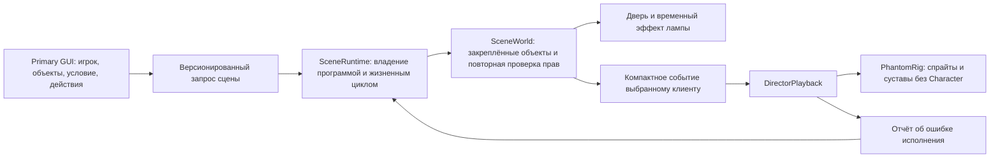

> Исторический отчёт предыдущего этапа. Текущее состояние Live Editor, схемы свойств и проверок описано в [LIVE_EDITOR_ARCHITECTURE.md](LIVE_EDITOR_ARCHITECTURE.md) и [LIVE_EDITOR_VERIFICATION.md](LIVE_EDITOR_VERIFICATION.md). Числа и сетевые контракты ниже не заменяют эти актуальные отчёты.

# GM platform: состояние реконструкции

Работа **не является завершённым импортом трёх систем или принятой игровой сборкой**. Здесь зафиксирован реализованный и проверяемый офлайн срез, а ниже — оставшийся охват. Полнота исследования, игровая надёжность и визуальное качество не выводятся из успешной компиляции.

## Источники и ограничения исследования

* Primary Package: локальный репозиторий `LocalMods/Primary package`, исходная ревизия `7fc4044`. Существующее изменение `filelist.xml` не принадлежит этой работе.
* GM Tools: установленная Steam-копия `C:/Steam/steamapps/workshop/content/602960/2829470717`, версия 2.0.3. Профильная установленная копия имеет ту же версию. Изучены регистрация команд, восстановление прав, модуль предметов, основные команды подлодок, санкции, сообщения и смайты; это не означает построчную проверку всех 54 файлов.
* GM Menu: найден `C:/Steam/steamapps/workshop/content/602960/3699710631`, версия 7.9, gameversion 1.13.4.0. Изучены каталог действий, серверные обработчики, контекстные сценарии, конфигурация узлов, маркеры и протокол динамических подлодок. В профиле `WorkshopMods/Installed/3699710631` копия не найдена. [Первичная страница автора](https://steamcommunity.com/sharedfiles/filedetails/?id=3699710631) отдельно предупреждает о проблемах позднего подключения при SpawnSub. Наличие в 7.9 собственного позднего манифеста не доказывает устранение этих проблем.
* Space Stories: `C:/ss14/space-stories-cm14`, commit `024d853a18`. Изучены реальные admin verbs, категории прав, админ-меню, VV, объектная панель, журнал и изменение прав. Полный семантический разбор всей административной инфраструктуры ещё не завершён.
* SCPITD: код эмоций импортирован из указанного `LocalMods/scpitdcode`; каталог и собранные звуки найдены в `LocalMods/scpitd-code-side`. В первом каталоге нужных файлов Content нет. В `emotion-import.json` записаны пути и SHA-256 каждого входа; `Tools/import_emotions.py` воспроизводит адаптацию.

`gm-source-inventory.json` содержит хешированную карту 54 файлов GM Tools, 85 файлов GM Menu и 537 файлов SS14/RobustToolbox, а также найденные объявления. Метка `inventory_only` буквально означает инвентаризацию, а не законченный анализ функции. Регистрация действия и его серверный обработчик могут быть двумя записями одной функции; количество записей не является числом реализованных возможностей.

Код, классы, архитектура, интерфейс и ресурсы GM Menu в Primary Package не импортировались. Его функциональные идеи исследовались отдельно от собственной реализации.

## Архитектурные замены

1. Старый экран последовательностей заменён редактором программы сцены. `SceneProgram` описывает предметные действия; `SceneBindings` задаёт параметры конкретного запуска. Сохранённый пресет не содержит привязок к сетевым ID игрока, двери, лампы или подлодки.
2. `SceneRuntime` — чистое ядро. Оно владеет копией программы, устойчиво сортирует действия с одинаковым временем, обрабатывает фронты условий, повтор, паузу перед повтором, отмену, ошибки и ревизии. Монотонные ревизии не допускают ABA при удалении и повторном создании сцены с тем же Guid.
3. `SceneWorld` закрепляет ссылки на настоящие дверь, лампу и подлодку. Повторное использование ID после удаления не переносит сцену на другую сущность. Права и доступность игрока проверяются при наблюдении и перед действием. Опрос ограничен 32 сценами с частотой до 10 Гц; обходов `MapEntityList` в новом пути нет.
4. `TimedLeases` заменяет единственный срок мерцания на отдельные владения временными эффектами. Отмена одного GM сохраняет воздействие другого на ту же лампу. Нативная случайная ветка blackout/zap для GM-эффекта больше не активируется: используется плавная модуляция 0.8 Гц с минимальной яркостью 65%.
5. Галлюцинация имеет собственную модель представления. Она использует спрайты, масштаб текстур и соединения ragdoll, но не создаёт `Character`, AI, PhysicsBody или серверную сущность. Рендер встроен перед передними структурами и последующей композицией освещения; фактический вид и LOS ещё требуют визуального испытания.
6. `PhantomMotion` непрерывно вычисляет движение. Режим сбоя удерживает только представленную позу, направление и положение; предыдущая поза служит ghosting. Дистанция реакции, скорость, радиус, масштаб и интенсивность задаются данными. Длина визуального цикла привязана к габариту модели.
7. `DeviceEditor` задаёт разрешённую схему из 29 технических настроек. Сервер выдаёт снимок с токеном конкретного предмета; изменение проверяет ожидаемое текущее значение. Передаются индекс компонента и ID поля. Это обходит неоднозначность штатного `ChangeProperty`, который читает свойство по имени и может выбрать первый одноимённый компонент.
8. Реестр изменений устройств хранит ссылки и ключи изменённых настроек; значения читаются из самих устройств. Поздняя синхронизация отправляется ограниченными порциями; клиент ожидает `FullyInitialized` и обрабатывает до 32 записей за обновление. Удалённые предметы исключаются из реестра. Фактическая межканальная очерёдность спавна и этих событий ещё не проверена в игре.
9. SCPITD-эмоции включены в существующее RP-колесо: единый каталог, 18 эмоций, 25 неизменённых звуков, серверные ограничения состояния, занятых рук, речи, повтора и одновременного исполнения; выбор варианта, синхронизация активного исполнения и отмена. Траектории рук используют Hermite-кривые с ограничением касательных и IK. Модуль сдачи в плен SCPITD не заменён фиктивным состоянием.
10. `GUIMotion` поддерживает конечные анимации с линейной, quintic и монотонной cubic Bezier кривой и аналитической скоростью. Окна используют новую анимацию; пружинная модель остаётся для прокрутки и непрерывного переназначения цели.
11. GUI различает скрытие окна для выбора точки и уничтожение. Открытые рабочие окна замораживают управление направлением персонажа. Назначенные клавиши Voice/RadioVoice/LocalVoice проходят через GUI, пока нет текстового ввода; при вводе текста голосовая активация подавляется.
12. Клиентские взаимодействия и эмоции подписаны на завершение раунда. Очистка сцен выполняется до уничтожения проигрывателя, поэтому отмена не обращается к освобождённой зависимости.

Сетевые каналы изменены на `pp.interactions.v3` и `pp.emotes.v2`; клиент и сервер должны использовать согласованные исходники. Существующий GMToolsAdapter и наследование его прав сохранены. Старые одиночные последовательности звука/скримера/текста преобразуются при чтении; многопользовательская последовательность старого формата требует ручного переноса и сообщается как несовместимая, исходный файл сохраняется.

## Матрица функционального охвата

«Адаптировано» ниже означает наличие реализации в исходниках и указанного офлайн-доказательства. Это не отметка игровой приёмки. Для всех записей исходной инвентаризации, не раскрытых ниже, статус остаётся `inventory_only / not_claimed`.

| Возможность и источник идеи | Польза и применимость | Выбранная реализация / ресурсы | Статус и доказательство | Существенный остаток |
|---|---|---|---|---|
| SS14 AdminVerbSystem; GM Menu RMB: контекст объекта | Прямой выбор игрового объекта | DeviceView, существующий WorldQueryService, точная проверка Item.IsMouseOn | Адаптировано частично; сборка | Структуры, отсеки и подлодки пока не включены в общее выделение; поиск по центру ограничивает очень крупные предметы |
| SS14 ObjectsTab, GM Tools nearchars/nearitems | Поиск персонажей, предметов и вложенных инвентарей | Существующий пространственный индекс и запросы GUI | Сохранено; сборка | Это не полный поиск по всему уровню или новая система массового выделения |
| GM Tools itemedit; GM Menu properties | Изменение конкретного технического компонента | DeviceEditor, DeviceServer, DeviceClient; 29 полей | Адаптировано; ABI полей по установленным сборкам | Живые изменения и поздняя синхронизация не приняты |
| GM Tools Door.open | Управление дверью | Поле конкретного Door и действия сцены | Адаптировано; ABI и сборка | Проверить сломанную/сваренную дверь и повторные компоненты в игре |
| GM Tools Quality.level | Качество предмета | Нативная граница Quality.MaxQuality | Адаптировано; ABI | Совместимость расширителей качества требует отдельной проверки |
| GM Tools Holdable.attach | Крепление оборудования | Нативные AttachToWall/DeattachFromWall | Адаптировано; сборка | Прикрепление/открепление и физическая синхронизация не проверены живьём |
| GM Tools Holdable.pick; GM Menu inventories | Передача и экипировка предметов | Должен использоваться нативный Inventory с проверкой вместимости | Не реализовано в новом GUI | Нужны реальные операции со слотами и вложенными контейнерами |
| GM Tools аккумуляторы, PowerTransfer | Энергосистемы | Заряд, ёмкость, отдача, зарядка, разрешение перегрузки | Адаптировано; ABI | Проверить ограничения устройств и взаимодействие модов |
| GM Tools Engine, Pump | Тяга и балласт | Текущие/предельные настройки, насос включён | Адаптировано; ABI | Нет доказательства безопасности произвольных крупных значений в полной физике |
| GM Tools Reactor | Реактор | Питание, авторегуляция, текущие/целевые реакция и турбина, мощность, задержки, топливо, температура | Адаптировано; ABI | Автоматическое управление может немедленно менять текущее значение; CAS тогда требует обновления |
| GM Tools Fabricator, Deconstructor, OxygenGenerator, Vent | Техническое обслуживание | Явные поля разрешённой схемы | Адаптировано; ABI | Производственные циклы и сеть требуют живого испытания |
| GM Tools DockingPort.dock | Стыковка выбранных портов | Нужны две закреплённые ссылки и проверка нативной стыковки | Не реализовано | Не заменено переключателем без выбранного второго порта |
| GM Tools chardata/humanlist/spawnchar; SS14 player/entity panels | Информация и создание людей | Существующие Character Studio, roster, permissions | Сохранено; сборка | Не является полным переносом управления игроками SS14 |
| GM Menu creatures; SS14 spawn | Настоящие существа из включённых пакетов | Существующая очередь Entity.Spawner; GUI поиска и выбор AI | Адаптировано | Позднее подключение к новым существам требует живого теста |
| GM Menu item spawn/presets, SS14 entity spawn | Выдача предметов и наборов | Следующий слой должен владеть очередью создания и результатом помещения в Inventory | Не завершено | Нет нового полного каталога предметов, избранного и истории |
| GM Menu afflictions; SS14 rejuvenate | Управление состоянием персонажа | Нативные CharacterHealth/AfflictionPrefab | Не реализовано в новом GUI | Требуется список текущих аффликций, целевых конечностей и операций лечения |
| SS14 permissions; GM Tools permissions | Делегирование возможностей | Существующий PermissionService; проверка на сервере и повторная проверка сцен | Сохранено и интегрировано; логические тесты отзыва прав | Не перенесены все ранги/группы и санкционные иммунитеты |
| SS14 adminhelp, GM Tools ahelp/adminpm | Связь игрока с GM | Существующие долговечные переписки F2 | Сохранено; сборка | Полная модерационная EUI-инфраструктура SS14 не перенесена |
| GM Tools adminchat/deadmsg | Отдельные административные/призрачные каналы | Требуется отдельная политика чтения и доставки | Не завершено | Не объявляется эквивалентом личных сообщений |
| SS14 logs/remarks, GM Tools sanctions/jobbans | Разбор инцидентов и модерация | Существующий аудит прав, сообщения и ModLog покрывают только часть | Частично / не завершено | Нужны полноценные заметки, санкции, jobban и GUI журналов |
| GM Menu Trigger Node | Автоматическая сценическая реакция | Собственные SceneProgram/SceneRuntime: открытие двери, вход выбранного игрока, ручной запуск | Адаптировано частично; регрессии фронтов и повторов | Не покрыты все условия и действия референса, цепочки узлов не импортировались |
| GM Menu Marker Node / monster call | Назначение маршрутов и управление NPC в радиусе | Требуется нативная постановка задач AI с устойчивым владением | Не реализовано | Отключение AI не выдаётся за маршрут к маркеру |
| Параметризованные хоррор-сцены | Повторное использование сцены с другими объектами | Клиентская библиотека программ, серверные привязки на запуск | Реализовано; тесты копирования и миграции | Общая серверная библиотека пресетов для нескольких GM отсутствует |
| Персональный монстр | Изолированное переживание одного игрока | PhantomRig/PhantomMotion, событие только целевому клиенту | Реализован клиентский путь; математика и сборка | Нет визуальной приёмки анимации, перекрытия и света |
| Чёрный искажённый монстр с имитацией лагов | Хоррор без блокировки игрового потока | Удержание представления, ghosting, затемнение, деформация позы | Реализовано; тесты движения и удержания | Полноэкранный пространственный shader/postprocess не реализован; GPU/FPS не измерялись |
| Персональные звук, скример и текст | Управляемые краткие воздействия | DirectorPlayback, каталог ресурсов, длительность/повтор/громкость, аудит ошибок клиента | Реализовано; сборка и кодек | Настоящее прослушивание и задержка запуска в игре не измерены |
| Световые сцены | Совместное временное влияние на лампы | TimedLeases и плавная клиентская модуляция | Реализовано; тесты двух владельцев/отмены/очистки | Это не универсальный редактор цвета, спектра и освещённости |
| Несколько GM | Отсутствие потери правок и взаимной очистки | CAS, ревизии, отдельные владения; уведомление о смене состояния | Логические регрессии проходят | Нет живого конкурентного испытания сетевого слоя |
| F2, RP-лента независимо от наблюдения | Работа GM во время управления персонажем | Существующий путь RP-сообщений; серверные эмоции также записываются в ленту | Интегрировано; сборка | Реальный ввод, голос и UI требуют испытания |
| Камеры, наблюдение, телепортация и контроль | Оперативная работа с игроком и миром | Требуется согласование с нативным владением персонажем/камерой | Не завершено | Новая полноценная панель этих операций отсутствует |
| GM Tools sublist/subdata/sublock/subgodmode/subtp/subthrow/subaddturretai | Управление подлодками | Исследованы отдельные реализации; нужна собственная модель операций | Не реализовано как новая согласованная панель | Не выдаётся за перенос возможностей подлодок |
| GM Menu SpawnSub и удаление подлодки | Динамическое расширение уровня | Нужен протокол начального состояния, ID, пакетов ресурсов и позднего подключения | Заблокировано для включения без доказанной сетевой реализации | Функция сознательно не добавлена; известный риск не воспроизводится новым небезопасным спавнером |
| GM Menu flood/drain, world points, sonar | Окружение и навигация | Применимы Hull и сонарные данные Barotrauma | Не реализовано | Не заменено локальными видимыми только GM метками |
| SS14 round/server controls | Управление раундом и сервером | Применимы только соответствующие нативные механики Barotrauma | Не завершено | Рестарт, настройки и модерация не собраны в новую панель |
| SS14 ECS VV, Toolshed/BQL | Инспекция и отладка | Полезны принципы ограниченного доступа и читаемого редактирования | Частично применимо | Копировать ECS/VV/Toolshed как фиктивную систему Barotrauma нельзя |
| SS14 газовые смеси, станции, реагентные решения, silicon laws | Предметные механики SS14 | Применимы только существующие механики целевой игры/модов | Прямой перенос неприменим | Возможность адаптации отдельных задач ещё требует разбора, не все функции семьи автоматически неприменимы |
| SCPITD эмоции и анимации | Выразительные RP-действия | Каталог, звук, ограничения, IK-траектории, серверные события | Адаптировано; все варианты каталога в офлайн-тестах | Нативное визуальное поведение рук в движении/воде/с предметами не принято |
| Кривые скорости GUI | Предсказуемая анимация инструментов | GUIMotion + MotionCurve | Реализовано; производные, монотонность, конечный срок и непрерывность пружины | Нет измерения задержки ввода и GPU-рендера GUI |
| Множественное выделение и массовые операции | Быстрая безопасная работа с миром | Нужны набор закреплённых ссылок, предварительная проверка и отчёт по каждому результату | Не реализовано | Однообъектный CAS не объявляется транзакцией массового изменения |

## Проверка и оставшаяся приёмка

Команды и границы доказательств перечислены в `GM_ACCEPTANCE.md`. Сборки и сырые результаты сохранены вне распространяемого мода в `C:/Steam/steamapps/common/Barotrauma/Docs/PrimaryPackage/Verification` и корневых `primary-*.log`.

Критерии «полная реконструкция», «полное исследование» и «готово к эксплуатации» остаются открытыми. Игра и dedicated server не запускались по действующим инструкциям. Коммиты, публикация и изменение `config_player.xml` не выполнялись. Сейчас конфигурация включает профильную Workshop-копию Primary Package, а не изменённый локальный репозиторий.
