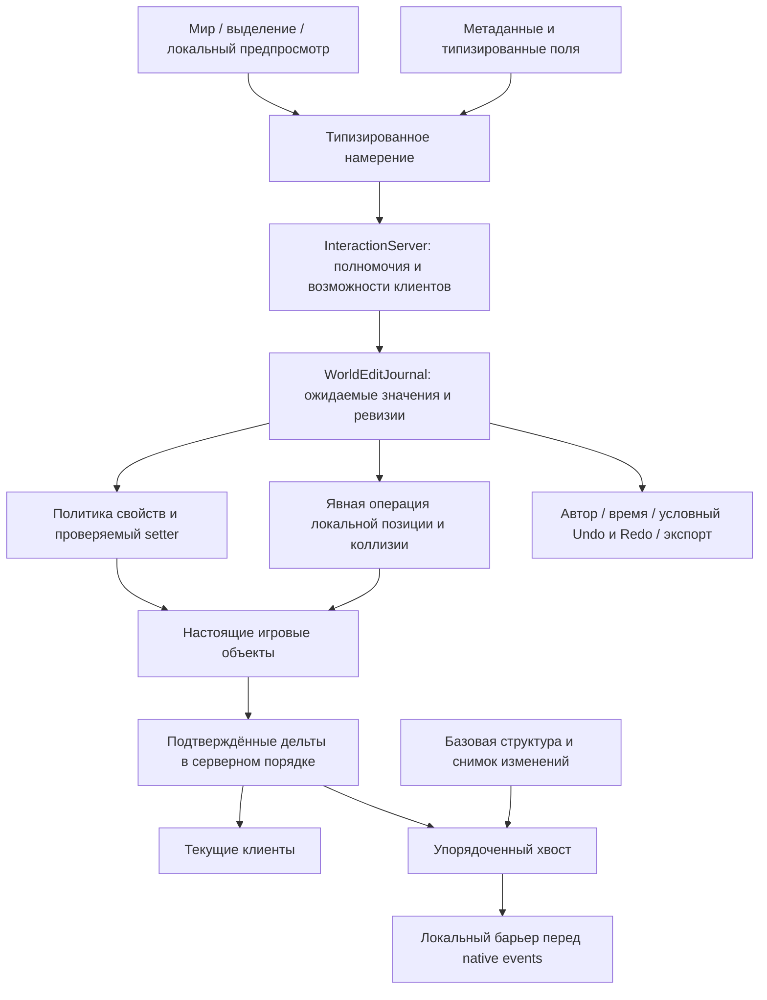

# Live Editor: архитектура и границы реализации

Дата: 2 ноября 2026. Канал взаимодействий `pp.interactions.v4`, обязательная схема возможностей **5**, транспорт снимков `pp.world.v1`.

**Полное ТЗ не выполнено.** Это существующая платформа редактирования настоящих объектов, расширенная в текущем проекте. Полный аналог штатного Submarine Editor, создание структурной геометрии, зависимое клонирование/удаление и SpawnSub пока не реализованы. Эти возможности не рекламируются в `WorldContract.Supported`. Игра и dedicated server не запускались.

## Подтверждённые причины и ограничения движка

| Статус | Установленный факт | Следствие |
|---|---|---|
| FINDING | `EntitySpawner` передаёт Item/Character. Заготовка SubmarineSpawnInfo проверяет Character в callback, серверный сериализатор не пишет подлодки | Нельзя считать его готовым SpawnSub |
| FINDING | Native `Entity.ID` — повторно используемый ushort; CreationIndex локален; IdRemap размещает ID загружаемого графа | Одного ID и совпадения prefab недостаточно для идентичности |
| FINDING | `Structure.Rect`, `Hull.Rect`, SubmarineBody и Item.StaticFixtures владеют разными зависимыми структурами | Изменение XML/Rect не является общей безопасной операцией геометрии |
| FINDING | Connection/Wire поддерживают обе стороны графа, узлы и dirty-состояние электросети; DockingPort владеет joint и связанными hull-данными | Нужны специализированные контракты топологии |
| FINDING | MidRoundSync воспроизводит события относительно существующего базового мира | Недостающие подлодки и геометрия должны появляться до зависимых событий |
| FINDING | contentserver не включал фактически загруженные подлодки в active claim | Разрешён точный канонический путь загруженного экземпляра с сохранением остальных ограничений |
| FINDING | contentclient мог продолжить конструктор после неудачного Rehydrate; восстановление содержало Thread.Sleep | Ошибка восстановления/происхождения теперь останавливает загрузку до native-конструктора; sleep удалён |
| PASS, offline | Активный contentclient — Workshop 3831040655. Его LoadPatches.cs и ResidentAsset.cs совпадают с исправленной локальной копией | Исправления установлены в реально включённую копию; config_player.xml не менялся |
| FINDING | В парных старых логах перед генерацией уровня у клиента 2590 сущностей против 2586 у сервера; четыре дополнительных маркера сдвинули ID Level | Подтверждена несовместимая исходная регистрация мира и последующий MISSING_ENTITY, но источник маркеров и связь со SpawnSub не доказаны |
| FINDING | Camera читает raw wheel и положение указателя независимо от Primary GUI | Ввод перекрыт в потребителях камеры/курсора, нативные поля и прокрутка GUI сохраняют raw input |
| FINDING | Native popup 7/10/11 игнорирует SenderName | Имя отправителя форматируется первой строкой тела окна одинаково для предпросмотра и доставки; реальный тип 11 сохраняется |
| FINDING | Старые 4 МиБ снимка не вмещали допустимые 4096 Unicode-свойств | Предел снимка выведен из максимального числа и размера полей, ниже лимита WorldBlob 16 МиБ |

Карта исходников движка с SHA-256 и строками методов: `C:/Steam/steamapps/common/Barotrauma/Docs/PrimaryPackage/LiveEditor/source-evidence.json`. Парные логи и номера строк: `event-graph-evidence.json` рядом. Эти данные не доказывают устранение исторической проблемы SpawnSub в игре.

## Общая модель редактирования

Источник порядка и журнала — существующий InteractionServer. Нет отдельной административной системы или второго протокола SpawnSub. Разные подсистемы имеют свои контракты; универсальный XML-сериализатор не используется.

`WorldEditKey` содержит инкарнацию, ushort-индекс экземпляра компонента и тип/имя свойства. Намерение содержит ID запроса, ожидаемые ревизию и значение, желаемый результат. Сервер проверяет полномочия, наличие/жизненный цикл цели, схему, диапазон и игровые инварианты до записи, затем проверяет фактический результат.

## Универсальные компоненты

`DeviceEditor.Schema` читает SerializableProperties и метаданные, требует Serialize, публичные getter/setter и поддерживаемый тип. Native InGameEditable допускаются по политике. Модовый тип регистрируется через `LiveComponentCapabilities.Register<T>()` до раунда; регистрация не открывает private fields, произвольные Serialize, editor-only поля или владельцев топологии.

Поддерживаются bool, int, конечный float, ограниченные string/Identifier, объявленные enum, RGBA Color и Vector2. Произвольные ссылки, массивы, Rectangle/Scale и внутренние поля закрыты. Door.IsOpen применяет отдельный проверенный TrySetState. Проводное соединение или Hull.Rect не маскируются под SetValue.

В установленных client/server сборках одинаковые **73 свойства** проходят схему. Инспектор строит GUI по общей схеме и обновляет значения без пересоздания активного поля ввода. Это не ручной набор команд на каждый вид оборудования и не обещание разрешить все свойства всех модов.

## Работа в игровом пространстве

F4 открывает редактор с существующей темой Primary GUI Engine. Основной экран остаётся игровым миром. Поддержаны индексированный hover, перебор перекрытий правой кнопкой, рамка, Ctrl-добавление/удаление из выделения, скрытые объекты и отображение кандидатов Hull/Gap/WayPoint. Выбор из перекрытий сохраняется при периодическом обновлении hover.

Отдельная камера редактора использует движущуюся систему подлодки: средняя кнопка — панорама, WASD/стрелки — движение, колесо — масштаб под курсором, предел 10 как в SubEditorScreen. При выходе восстанавливаются прежний вид и предел камеры. Ввод не передаётся персонажу. F2/F5 и обычные окна блокируют камеру; панели редактора разрешают ввод вне своих границ. Штатный SubEditorScreen не переносился в игровой жизненный цикл.

Сетка и привязка отключаются. Локальный предпросмотр перетаскивания не отправляет пакеты на каждом пикселе. Сервер получает завершённое намерение. Выравнивание по краям/центрам и распределение центров по X/Y имеют отдельное явное применение после предпросмотра, но используют общий контракт позиций и тот же журнал.

Неизменённые опоры выравнивания входят в ожидаемое состояние группы. Их позднее изменение вызывает конфликт всей операции. Они не перестраивают физику при нулевом перемещении. Escape отменяет предпросмотр до отправки и не закрывает редактор тем же нажатием.

BoundsIndex хранит AABB в локальной системе подлодки; изменения регистрируются через движок. Полного MapEntityList-обхода на каждом кадре выделения нет. Геометрическая математика отделена в EditorGeometry, ограничена 64 объектами и использует ограниченный stackalloc.

## Физические преобразования

`LiveItemTransform` пока допускает ограниченное статическое оборудование одной действующей подлодки. Door/Docking/Wire, контейнеры, Holdable, неизвестные модовые компоненты, активные тела и подключённые провода требуют специальных операций и отклоняются. Это существенное ограничение реализации.

`StaticFixtureTranslation` сохраняет объекты Circle/Polygon fixtures, фильтры, material, UserData и callbacks. Native Body.Remove/Add пересоздают контакты и broad-phase proxies; затем обновляется масса. Item.Move сопровождается FindHull. План умеет немедленно восстановить исходные формы, позиции и физические данные при отказе.

Проверяются physics-step, контакты, занятость конечной области, владение, неизвестные формы, прежние границы SubBody и flipped submarine. Не выполняется полная перестройка подлодки. Это не реализация изменения корпуса, границ воды, Hull/Gap или стыковочного графа.

## Конкуренция и история

Ревизии принадлежат адресам свойств/позиций, а не одному глобальному mutex редактора. Независимые изменения разных целей не затирают друг друга. В группе 1–64 объекта проверяется всё ожидаемое состояние. Сервер окончательно задаёт порядок.

На одного GM допускается одно ожидающее групповое преобразование. Привязки участников подтверждаются клиентами; срок ожидания ограничен 10 секундами, без произвольной задержки и без удержания мировой блокировки. За update подтверждаются не более двух групп, GM обходятся по кругу. Доставка подтверждённых преобразований ограничена очередью 32 группы на клиента и двумя отправками за update.

WorldEditJournal хранит до 4096 изменений, ID запросов, автора, время и результат. Повтор запроса идемпотентен. Undo/Redo — условные обратные операции: проверяются принадлежность, состояние истории, актуальная ревизия и значения всей группы. Поздние чужие изменения не перезаписываются. Undo возвращает конфигурацию/позицию; уже произошедшие затопление, урон, движение персонажа или контактные последствия не перематываются.

При отказе исполнения проверяется восстановление всей группы. Неполный rollback переводит журнал в Faulted и останавливает дальнейшие записи до нового раунда. UI показывает последние 16 операций. Экспорт создаёт отдельный журнал на сервере; исходные .sub не перезаписываются. Переносимые пресеты и сохранение полноценного нового blueprint ещё отсутствуют.

## Сеть и поздний вход

`BitStream` использует bounded Span, little-endian bit fields, canonical varint/zigzag, GUID, строгий UTF-8, конечные float и нулевое padding. NativeWire заимствует проверенный участок native Buffer только на время receive callback. TranslationWire передаёт позиции и ревизии, включая разные векторы выравнивания, без строкового ASCII framing.

WorldBlob владеет неизменяемыми байтами. Передача — chunks 768 байт, selective repeat до 32 слотов, pacing, ACK bitmap, adaptive RTT/RTO с Karn, congestion window, CRC32C пакета и SHA-256 целого снимка. Нет unsafe/SIMD ради формальности. Отсутствие реального прогресса в течение 60 секунд завершает синхронизацию с диагностикой; общее время передачи этим не ограничивается.

Порядок подключения:

1. Hello согласует capabilities и схему 5. Несовместимая версия отклоняется до разбора новых контрактов.
2. Snapshot передаёт world epoch. Accept/Offer содержат epoch и flow; запоздалые запросы другого раунда/потока не создают новую сессию синхронизации.
3. После native GameScreen.Select клиент подтверждает создание исходного мира. Проверяется настоящий IL установленной сборки: вызов Screen.Select, не предположение по имени исходного override.
4. NativeWorld сравнивает construction-time digest графов. Идентичность исходных сущностей выводится из epoch+ID только для точных исходных object references. Случайное переиспользование ID не является автоматической перепривязкой.
5. Сервер захватывает базовую структуру и изменения исходных native items на одном cut; кодирование/хеширование и декодирование работают с принадлежащими задачам снимками вне simulation update.
6. Клиент полностью получает, проверяет и применяет снимок до подтверждения применения. Заимствованный receive buffer не передаётся фоновой задаче.
7. Догоняющий журнал передаётся целыми операциями на надёжном упорядоченном канале. WorldReplayWindow ограничивает его 16 операциями / 128 КиБ консервативного byte budget, pacing по скорости клиента и coalesced application ACK.
8. Когда все изменения текущего send-side cut поставлены в очередь, вслед за ними идёт release marker на том же канале. Ожидание пустого окна ACK не требуется: это снова потребовало бы тихого RTT при непрерывных правках. Клиент интерпретирует все предшествующие операции до открытия локального барьера.
9. Начинается штатный MidRoundSync и последующее обновление устройств. Native timeout расширяется только при действительном продвижении event ID.

Готовность сетевого мира отделена от InteractionRecovery: ошибка чтения локальных переписок/черновиков диагностируется и повторяется отдельно, не сбрасывая согласование bootstrap. При восстановлении не заменяются новые уже полученные сообщения старыми записями outbox.

После подтверждения применения payload/sender снимка освобождаются; для идемпотентных повторов остаются ID потока и переданной части. Предел baseline рассчитан из числа/длины допустимых полей и вмещает весь допустимый Unicode-журнал, не превышая 16 МиБ транспортного слоя.

Это путь восстановления **редактируемых исходных Item**, а не динамических подлодок. Графы SpawnSub в снимке пока отсутствуют. Не заявляется поддержка динамической геометрии немодифицированными клиентами.

## F5: сообщения

F3 больше не перехватывается. F5 открывает получателя, формат, отправителя, текст, настоящую HSV-палитру, RGBA, сохранённые цвета, длительность/появление/исчезновение для ScriptToast, предпросмотр и историю.

Обычный msg — native Server (3) без отправителя. Именованный чат, popup 7/10/11 и ScriptToast — отдельные форматы. Sender выбирается как без имени, GM, сервер, своё имя, игрок или произвольное имя. Сервер сам разрешает имя из аутентифицированной сессии/roster, а custom name валидирует. Отключённый адресат не превращается во «всех».

Legacy-разрешение msg даёт чат, но не intrusive popup/ScriptToast. Общая выдача SendGMMessage и legacy message предоставляют соответствующие расширенные возможности. Маска форматов передаётся клиенту, а сервер повторно проверяет её на отправке.

Черновик включает все поля, сохраняет незавершённые числовые значения и принадлежит паре endpoint/account. Запись объединяется с существующим InteractionRecovery/AtomicStore: короткий debounce, принудительное сохранение при закрытии/reset/смене области, checksum, atomic replace, резервная копия. При отказе записи предыдущий черновик не заменяется молча другой областью.

История содержит последние 32 подтверждённые сервером отправки. Подтверждение означает постановку сервером в очереди получателей, не доказательство их отображения. Повтор создаёт новый request ID. Дубликат того же ID получает прежнюю квитанцию без повторного показа. История владеет копиями запроса и квитанции. Неподтверждённые сообщения после reconnect не отправляются автоматически; UI честно показывает неоднозначный результат при timeout.

## Замещённые механизмы

Заменены ID-only применение дельт, ручной каталог разрешённых полей, ASCII framing позиций, повторная полная пересылка состояния вместо упорядоченного хвоста, ожидание тишины за RTT, raw camera input сквозь Primary GUI и одноразовый F3-композер с жёстким GM. Старые независимые реализации этих путей не оставлены параллельно.

## Незавершённое и необходимая приёмка

**NOT IMPLEMENTED:** сетевые create/clone/delete со связанными объектами и обратимостью; стены/Structure/Hull/Gap и границы воды/кислорода; редактор проводного графа и docking; поворот/resize; настоящий каталог строительства; динамический graph baseline и SpawnSub; переносимые пресеты и новый .sub blueprint.

SpawnSub потребует согласованных resource preflight, ID allocation/remap до native-регистрации, подготовки полного графа, изоляции тел/отложенных спавнов и событий, проверки зависимостей, подтверждения клиентами и общего commit/ready barrier. Submarine.Remove отдельно от удаления всех MapEntity не является rollback графа. Это требования дальнейшей реализации, не готовая функция.

**NOT_RUN:** производственный GUI и камера в игре; native physics integration; несколько GM; реальный MidRoundSync после правок; реальная потеря/перестановка пакетов и reconnect; CPU/GPU/GC и трафик всего игрового пути. Офлайн-тесты не закрывают эти пункты.
