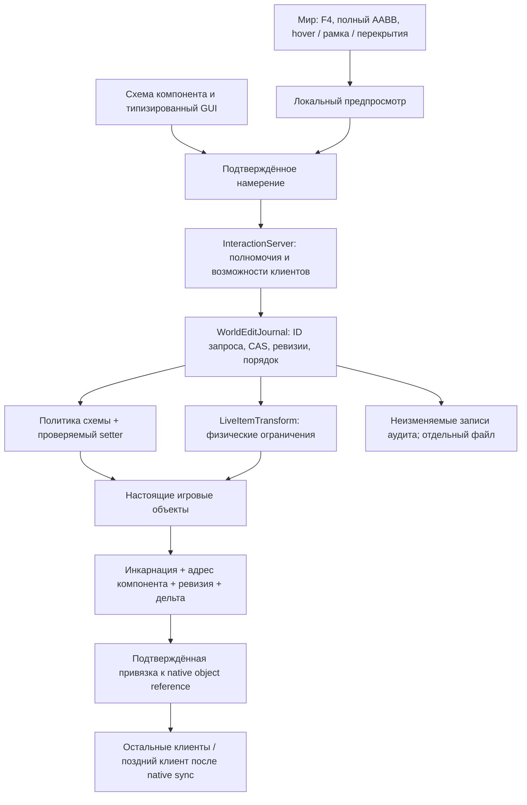

# Live Editor: реализованный срез и незавершённая структурная платформа

Дата: 1 ноября 2026. **Полное ТЗ не выполнено.** Полноценный сетевой редактор подлодки и SpawnSub ещё не реализованы. Этот документ отделяет работающий офлайн-контракт от проектируемых механизмов. Игра и dedicated server не запускались.

## Подтверждённые находки

1. **EntitySpawner не является транспортом подлодок.** В shared `SpawnableType` только Item/Character; серверный `ServerEventWrite` пишет только эти ветки. Заготовка `SubmarineSpawnInfo` создаёт Submarine, но её callback проверяет Character. Она не доказывает наличие рабочего пути SpawnSub и не установлена как причина конкретного исторического инцидента.
2. **Native ID не является поколением.** `Entity.ID` документирован как непостоянный, назначается через поиск свободного ushort и может использоваться снова. `CreationIndex` локальный; равенство его значений на разных процессах не гарантируется. `IdRemap` решает размещение ID при загрузке, а не жизненный цикл сетевого редактора.
3. **Старая дельта устройства могла попасть в замену.** Прочитанный исходный DeviceClient искал Item по ID и сравнивал prefab. Совпадение этих двух значений после удаления не доказывает идентичность экземпляра. Новый путь закрепляет объект и серверную инкарнацию; автоматическая перепривязка дельты отсутствует.
4. **XML и Rect не описывают всю физику.** `Structure.Rect` пересоздаёт sections и их тела; `Hull.Rect` меняет массивы волн, кислород, поверхность и пересчитывает hull-ссылки. При этом `SubmarineBody` отдельно строит границы/convex hull и fixtures статических предметов. Перенос Item через Move не переносит эти fixtures. Наличие выключенного item.body не означает отсутствие коллизии. Такой перенос отклоняется до записи.
5. **Провода — граф с побочными эффектами.** Wire.Connect меняет обе стороны, узлы, ConnectedDirty, состояние предмета и иногда его физику. ConnectionPanel.ServerEventRead проверяет доступ персонажа, панель, ограничения проводов и успех действия. Его нельзя вызвать как готовый административный обход или заменить SetValue/XML.
6. **Стыковка — связанная структура.** DockingPort владеет joint, целевым портом и связанными hull-данными. Прямая запись свойств не заменяет Dock/Undock и восстановление топологии.
7. **MidRoundSync воспроизводит события, а не создаёт произвольный базовый мир.** UniqueEvents ссылаются на уже существующие объекты. Клиент должен сначала иметь подлодки/геометрию, на которые эти события ссылаются. Ожидание FullyInitialized после начала потока не исправляет отсутствие базовой структуры.
8. **contentserver пропускал загруженные динамические подлодки в active claim.** Проверялись lobby/owned/session, но не Submarine.Loaded. Исправление разрешает только точный канонический путь фактически загруженного экземпляра. Public/Protected/Browsed и запечатывание передачи сохраняются.
9. **contentclient игнорировал неудачу Rehydrate перед конструктором.** Скудный XML сохраняет ID, но не геометрию/компоненты. Теперь неудача восстановления или подмена происхождения останавливает вход в конструктор. Синхронные Thread.Sleep из восстановления удалены.
10. **Активная клиентская копия другая.** config_player.xml включает Workshop 3831040655 (`contentclientfixed`), а не LocalMods/contentclient. Workshop-копия содержит прежние Rehydrate/Sleep. Исправлен локальный исходный проект из задания; активная копия и config_player.xml не изменены.

Пункты 8–10 подтверждают конкретные условия отказа в коде. Без логов не установлено, какое именно условие вызвало прежнюю невозможность входа. Нельзя объявлять историческую проблему SpawnSub устранённой.

Хеши 30 изученных файлов движка и строки ключевых методов: `C:/Steam/steamapps/common/Barotrauma/Docs/PrimaryPackage/LiveEditor/source-evidence.json`. Это карта доказательств, а не утверждение о полном аудите всего движка. Ранее собранные референсы GM Tools/GM Menu/SS14 сохранены в GM_RECONSTRUCTION.md и gm-source-inventory.json. Их код и административная система не импортированы.

## Что можно переиспользовать

| Механизм | Решение во время раунда |
|---|---|
| SerializableProperty, Serialize, InGameEditable | Обнаружение метаданных и типизация; отдельная политика разрешения и проверка записи |
| SerializableEntityEditor | Правила типов/локализации полезны; его дерево GUI и жизненный цикл не перенесены |
| MapEntityPrefab.List | Настоящий объединённый каталог CoreEntity/Structure/Item/Assembly; размещение должно иметь отдельные контракты, сейчас не включено |
| Item.Move + FindHull | Используются только в ограниченной зарегистрированной операции перемещения; fixtures, провода, инвентари и топология исключены |
| Door.TrySetState | Специальный исполнитель состояния двери с нативными побочными эффектами; не прямой IsOpen setter |
| MapEntity.Clone / MapLoaded | Требуют замкнутого графа зависимостей, remap и согласования сетевого рождения; не вызываются общим GUI |
| SubEditorCommands | Локальные editor-команды сохраняют Rect и живые ссылки; не обеспечивают серверные ревизии или сетевой Undo |
| Submarine constructor | Глобально переключает World.Enabled, добавляет сущности, назначает hidden frame/offset, строит SubBody; не является атомарной сетевой транзакцией |
| ConnectionPanel.ServerEventRead | Контракт обычного персонажа; административный инструмент обязан валидировать отдельное типизированное намерение |

## Реализованная архитектура

Владельцем журнала и порядка является существующий InteractionServer. Не добавлен второй административный модуль или независимый транспорт SpawnSub. Канал обновлён до `pp.interactions.v4`; клиент и сервер должны обновляться вместе.

### Универсальная схема

`DeviceEditor.Schema` читает SerializableProperties конкретного типа, требует Serialize, публичные getter/setter, поддерживаемый тип и разрешающие метаданные. Native InGameEditable допускаются по политике; модовый тип требует `LiveComponentCapabilities.Register<T>()` до раунда. Регистрация не открывает private fields, обычные Editable, произвольные Serialize или топологические владельцы. Door.IsOpen — отдельный проверенный исполнитель через TrySetState.

Типы: bool, int, конечный float, ограниченные string/Identifier, объявленные enum, RGBA Color и Vector2. Проверяются диапазоны, длина, численная конечность и формат. Ссылки на произвольные объекты, произвольные массивы, Rectangle/Scale и внутренние поля закрыты. Это намеренно ограниченная поддержка, а не обещание редактировать любое свойство любого мода.

Адрес содержит инкарнацию Item, ushort-индекс **экземпляра** компонента, полное имя типа, имя свойства, ожидаемую ревизию и ожидаемое значение. Индекс не ограничен байтом и не выбирается «первый компонент с таким свойством». Клиентская схема перепроверяется; сервер не доверяет GUI.

В установленных клиентской и серверной сборках найден одинаковый набор из **73 свойств**. Проверены реальные метаданные и парсинг, без исполнения native setters в игровом мире. Это не «все поля движка». Обычные editor-only параметры реактора/насоса из прежнего ручного каталога автоматически не открыты.

### Отбор и GUI

BoundsIndex хранится в локальной системе подлодки, поддерживает AABB, большие объекты и широкий marquee. Его клетки обновляются по изменениям сущностей. Начальное заполнение допустимо один раз; MapEntityList не обходится на каждом кадре выделения. При повторном использовании ID подлодки создаётся новый frame. Узкая проверка использует нативный IsMouseOn, порядок — SpriteDepth и ID. Hull/Gap/WayPoint показываются по отдельному переключателю.

Инспектор — компактное боковое окно с поиском, группировкой по экземплярам компонентов, bool/enum, числовыми полями и палитрой цвета. Обновление значений не пересоздаёт ввод. Правка удерживает исходную ревизию; кнопка актуализации явно начинает редактирование с нового значения. Persistent overlay редактора отделён от временных блокирующих overlays: открытие инспектора и других окон не уничтожает выбор.

Перетаскивание рисует только ghost-контур. Завершённое намерение отправляется при отпускании кнопки. Используется native GridSize. Смена подлодки предмета меняет серверную идентичность frame; совпадение X/Y не позволяет применить старую операцию в другой системе координат.

Текущий выбор нескольких объектов служит выделению. Групповые преобразования, выравнивание, группировка и полноценная работа со слоями **не реализованы**.

### Согласованность и Undo/Redo

Сервер последовательно выполняет принятые операции на игровом потоке. Ревизии принадлежат адресу конкретного свойства или позиции; независимые поля не блокируют друг друга. CAS проверяет и ревизию, и фактическое значение, поэтому естественное изменение устройства может отклонить правку. Последующие GM-изменения A→B→A не скрывают конфликт Undo.

Журнал сохраняет автора, запрос, цель, значения, ревизию и время. Неизменяемая история Changes отдельно хранит Apply/Undo/Redo. Повтор исходного запроса не исполняется повторно, в том числе после Undo. Чужую операцию отменить нельзя. Отмена старой операции не затирает более позднюю запись. Удалённая инкарнация не переносится на новую сущность.

Undo восстанавливает только настройку/разрешённую позицию. Он не восстанавливает воду, нанесённый урон, заработанную энергию, выполненные status effects или прочую прошедшую симуляцию. Лимит истории — 4096 событий, после заполнения новая операция отвергается до изменения. GUI показывает последние 16 исходных операций; полный аудит доступен явным экспортом. Структурные зависимости, региональные блокировки, атомарные группы и обратимость создания/удаления пока не реализованы.

Экспорт сохраняет снимок журнала в `Data/Interactions/WorldExports/*.json` через AtomicStore. Снимок формируется на игровом потоке, сериализация/IO — в отдельной Task без доступа к engine objects. Это **аудит раунда**, не .sub, переносимый preset или готовое восстановление мира. Исходные .sub код экспорта не записывает.

### Доставка и поздний вход текущего среза

1. Hello согласует протокол/версию схемы и возможности. Структурная геометрия и SpawnSub не объявляются поддерживаемыми.
2. Клиент сообщает готовность после GameSession.IsRunning и завершения native MidRoundSync.
3. Если сообщение готовности обогнало серверное окончание native sync, запрос сохраняется; его выполнение зависит от состояния, а не случайной задержки.
4. Сервер предлагает инкарнацию/ID/prefab. Клиент закрепляет ссылку только на FullyInitialized Item и подтверждает её пакетами до 16 объектов.
5. Сервер повторно проверяет свою живую ссылку перед выдачей текущих изменённых значений. Клиент никогда не ищет новую цель для уже привязанной дельты.
6. Передаются текущие значения мира, а не устаревший набор After из истории. Удалённые привязки освобождаются.

Предложения ограничены 8 за серверное обновление, replay — 8 полей за обновление на сессию. Подтверждения пакетируются с частотой до 8 сообщений/с, чтобы не исчерпывать общий лимит запросов. Это управление нагрузкой, не ожидание инициализации. Наблюдение инспектора — до 2 Гц, только изменённые значения, до 8 дельт за проход с циклическим курсором. Снимки разбиты по 8 полей; максимум 512 полей на объект, 1024 текущих редактируемых объекта. Нативные сообщения остаются на штатном транспорте.

Редактирование не выполняется, если активный участник не согласовал нужные возможности. Вход в уже отредактированный раунд без согласованного v4 явно отклоняется у native InitClientMidRoundSync с сообщением о несовместимости. Испытание реального порядка Hello/join и host-client ещё обязательно.

**Этот порядок пригоден только для имеющихся native сущностей и реализованных изменений.** Он не создаёт динамическую геометрию до native событий и потому не закрывает SpawnSub.

## Требуемый следующий структурный слой — проект, не готовый код

Общий журнал должен получить типизированные операции CreateGraph/DeleteGraph/TransformGeometry/Connect/Disconnect/SpawnSub. Каждая заранее вычисляет замыкание затронутых сущностей и read/write dependencies. Проверяются существование, поколения, ревизии, занятость, габариты и ресурсы. Кратковременная блокировка нужна этому замыканию, а не всей подлодке.

Для стен/помещений план должен отдельно содержать sections/fixtures, SubBody extents, hull/gap и fluid-ссылки, item/character hull membership, свет/convex hull, waypoints/AI и данные сети. Политика воды/кислорода должна быть явной; смена объёма не является нейтральной операцией. Изменение занятых областей и активных joint требует предварительного отказа или специального сценария. Сначала полная валидация и резерв ресурсов, затем изменение вне physics step, затем проверка результата и публикация.

Для SpawnSub требуется согласованная базовая структура **до** native entity-event flood: манифест ресурсов/контента, серверный экземпляр и frame, занятый блок ID и полный remap, геометрия и объекты, инвентари/соединения, вторичная инициализация, контроль целостности и явный AckReady. Простого Submarine.Load или EntitySpawner недостаточно. Существующий защищённый FileSender/lease остаётся путём контента, не заменяется открытой передачей XML.

Поздний клиент должен получать снимок на последовательности S, создать структуру, подтвердить готовность, затем восстановить изменения после S без пропусков/повторного исполнения и перейти к native sync/catch-up. Структурные удаления и события, ссылающиеся на ещё неизвестные объекты, должны удерживаться соответствующим барьером. Требуются измерения нагрузки, сохранение bounded backlog и политика повторного снимка при переполнении. Это важный отсутствующий интерфейс интеграции; текущий post-native replay его не заменяет.

## Статусы приёмки

| Требование | Статус | Фактический охват |
|---|---|---|
| Исследование жизненного цикла и зависимостей | FINDING | Карта методов и подтверждённые ограничения; не полный аудит движка |
| Универсальные типизированные свойства | PASS / NOT_RUN | Офлайн-схема/валидация/сборка; исполнение на оборудовании в игре не принято |
| Hover, перекрытия, рамка, moving-frame preview | PASS / NOT_RUN | AABB-регрессии и сборка; native UI не снят и не проверен визуально |
| Конфликты, дедупликация, условные Undo/Redo | PASS / NOT_RUN | Production-ядро в тестовом мире; несколько реальных GM не запускались |
| Разрешённое перемещение оборудования | NOT_RUN | Есть ограниченный исполнитель; native физика не исполнялась |
| Каталог/создание, копирование, удаление в журнале | FAIL | Не реализовано; существующие административные EntityActions не считаются редактором |
| Стены, Hull/Gap, провода, docking editor | FAIL | Не реализовано, опасные операции закрыты |
| Поворот/размер/групповые операции | FAIL | Не реализовано |
| Динамические подлодки и pre-native baseline | FAIL | Не реализовано |
| Blueprint export, импорт и переносимые presets | FAIL | Есть только отдельный экспорт аудита |
| F3 | PASS / NOT_RUN | Сборка, native тип 11, codec; фактическое отображение/доставка не приняты |
| Возрождение после удаления тела | NOT_RUN | Сохранённая личность, native spawn/control, правила режима; полноценного runtime-теста нет |
| Black Glitch / Phantom Encounter / Signal Collapse | PASS / NOT_RUN | Чистая математика и сборка; GPU/визуальная приёмка отсутствует |
| Историческая причина неудачного входа | FINDING | Найдены условия отказа; конкретная сессия без логов не диагностирована |
| Игровая/сетевая приёмка | BLOCKED / NOT_RUN | Действует запрет запуска игры и dedicated server |

Воспроизведение доступных проверок: `Tools/verify_live_editor.ps1`. Результаты и обязательная игровая матрица — LIVE_EDITOR_VERIFICATION.md.
